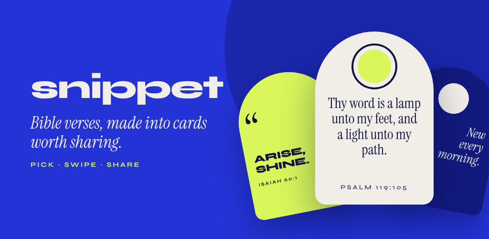

<p align="center">
  
</p>

<p align="center">
  
</p>

# Snippet

Bible verse quote cards. Pick a verse, style it, export a PNG, save or share.

Built with Flutter for Android and iOS (`com.arthur.snippet`). Website: [snippetverses.app](https://snippetverses.app).

## Features

- **Offline Bible**: KJV and WEB are bundled as assets, so picking a verse never needs a network.
- **Pick any passage**: any book, chapter and verse range, with a KJV / WEB toggle.
- **Cobalt swipe design**: swipe up through 6 card styles (Vigil, Riso Loud, Dawn, Swiss, Night Watch, Cobalt Arch) and sideways through each style's colourways.
- **Three export shapes**: Feed 1:1, Portrait 4:5 and Story 9:16, each laid out natively. Exported as PNG, saved to the gallery or shared.
- **Optional account**: email and password or Google sign-in only gates the Library. Picking, swiping and exporting never need it.
- **Library**: saved cards sync to your account through Firestore.
- **Hot content**: featured verses and an announcement banner come from Firebase Remote Config, with bundled fallbacks.
- **Verse reminders**: local notifications, no server involved.

## Bible texts: public domain

The **King James Version (KJV)** and the **World English Bible (WEB)** are in the public domain.
The text files come from [eBible.org](https://ebible.org) verse-per-line downloads
(`eng-kjv_vpl.zip`, `eng-web_vpl.zip`) and are converted by `tool/build_bibles.py`.

- WEB: dedicated to the public domain; if you change the text you may not call it the "World English Bible".
- KJV: public domain worldwide except the UK, where the Crown holds letters patent over *printing*.
  (Cambridge/Oxford University Press and Collins hold the right to print it in the UK.)

The app code is MIT licensed (see `LICENSE`).

## Project structure

```
lib/
  main.dart                       entry point (Firebase init, falls back to offline services)
  app.dart                        MaterialApp + dependency wiring
  core/                           app theme; theme/ holds color tokens + font styles
  cards/                          card design system: shapes, palettes/, styles/, QuoteCard
  data/                           Bible models/repository, saved cards, settings, JSON store
  features/
    home/                         verse of the day + "Pick a verse" panel (wheels, book sheet)
    swipe/                        style swiper (vertical styles, horizontal colourways)
    all_styles/                   every style at once, with filters
    export/                       "Share it" sheet: shape, Snippet mark, save/share PNG
    auth/                         optional sign-in sheet (shown on Save)
    library/                      saved cards grid + empty state
    profile/                      account, preferences, about
  widgets/                        shared chrome: header, arch panel/sheet, pills, switch, icons
  services/
    auth_service.dart             AuthService + LocalAuthService (offline fallback)
    firebase_auth_service.dart    Firebase email/password + Google sign-in
    content_config_service.dart   ContentConfigService + LocalContentConfigService (bundled defaults)
    firebase_content_config_service.dart  Remote Config: verse_calendar, fallback_verse, announcement
    export_service.dart           PNG capture, save to gallery (gal), share (share_plus)
    services.dart                 InheritedWidget container for the services above
assets/bibles/{kjv,web}.json      66 books; {id,name,license,books:[{id,name,chapters:[[verse,...]]}]}
assets/fonts/                     Syne, Instrument Serif/Sans, Cormorant Garamond, Space Mono,
                                  Bricolage Grotesque (all SIL OFL 1.1, licenses alongside)
tool/build_bibles.py              regenerates the JSON assets from eBible.org files
test/                             repository, export, and widget tests
```

## Develop

Requires the Flutter stable SDK (developed on 3.47) and, for device builds, the Android SDK / Xcode.
Android minSdk is 24 (required by the `gal` plugin).

Set up Firebase first (see [Firebase setup](#firebase-setup) below). A fresh clone does not include
`lib/firebase_options.dart`; without it, `flutter analyze` reports a missing import until you generate
or copy that file.

```
flutter pub get
flutter analyze
flutter test
flutter run
```

## Firebase setup

Sign-in and cloud library sync use Firebase. Configuration files are **gitignored on purpose** so API keys
and app IDs are not committed.

1. Create a [Firebase](https://console.firebase.google.com/) project and register the Android app
   (`com.arthur.snippet`) and iOS app (`com.arthur.snippet`).
2. In the Firebase console, enable **Authentication** → sign-in methods **Email/Password**, **Google**, and **Anonymous**.
3. Enable **Cloud Firestore** (start in test mode or add rules from `firestore.rules` as you prefer).
4. On your machine, install the FlutterFire CLI and generate config:

   ```bash
   dart pub global activate flutterfire_cli
   flutterfire configure
   ```

   This writes `lib/firebase_options.dart`, `android/app/google-services.json`, and
   `ios/Runner/GoogleService-Info.plist` (and macOS equivalents if you enable that platform).

   **Or** copy the template and fill in your project values:

   ```bash
   cp lib/firebase_options.dart.example lib/firebase_options.dart
   ```

   Then add `google-services.json` / `GoogleService-Info.plist` from the Firebase console if you build
   native Android or iOS targets.

5. Run `flutter pub get`, then `flutter analyze` and `flutter test`.

Do not commit `lib/firebase_options.dart`, `google-services.json`, `GoogleService-Info.plist`, or
`firebase_app_id_file.json`. Keep them on each developer machine or in CI secrets.

## Firebase services

The app runs fully offline if Firebase is unavailable (local auth, cards kept on the device).

- Services used: Authentication (email/password, Google), Firestore (Library), Remote Config.
- Email accounts must verify their address before completing setup or saving
  cards. Signup and unverified sign-in show a verification step with resend,
  status check, and account-switching actions. Returning from the browser
  refreshes verification automatically; dismissing or restarting does not
  bypass the requirement. Profile → Account also offers verification actions.
  Phone-only cards wait until verification before migrating to the cloud.
  Firestore rules also reject writes from unverified password sessions; deploy
  the updated rules with `firebase deploy --only firestore:rules` when releasing.
  Test them locally with `firebase emulators:exec --only firestore --project demo-snippet 'python3 tool/test_firestore_rules.py'`.
- Password resets are available through **Forgot password?** on sign-in and
  **Reset password** in Profile for password accounts. The response does not
  reveal whether an address has an account.
- **Change email** in Profile confirms the current password (or Google account)
  and sends a verification link to the new address using Firebase's
  `verifyBeforeUpdateEmail`. The old address stays active until verification.
  If Firebase expires the session afterward, sign in with the new address.
- These links use Firebase's hosted email action pages. In Authentication →
  Templates, configure the sender and email copy for verification, email changes,
  and password resets; retain the default Firebase action URL unless a custom
  handler implements those actions. No app deep link setup is required.
  Before release, use a test account and real inboxes to check registration,
  verification/resend, reset (including an expired link), and an email change
  followed by signing in with the verified address. Automated tests use fakes
  and do not send real mail.
- Remote Config parameters live in `remoteconfig.template.json`:
  `verse_calendar` (JSON object of the phone's local date to a ref, e.g. `{"2026-10-21": "ISA 40:31", "2026-10-22": "LAM 3:22-23"}`),
  `fallback_verse` (ref used for any day missing from the calendar; empty or unreadable = `GEN 1:1`) and `announcement` (text, empty = none).
  Edit them in the console, or `firebase deploy --only remoteconfig` (this replaces the console template).
  New values reach users on their next launch, which also reschedules the next 14 days of reminders from the calendar.
  Entries with a bad date or ref are skipped, so that day uses the fallback.
- Security rules are in `firestore.rules`.
- Add your debug and release SHA-1/SHA-256 to the Android app for Google sign-in.

## Contributing

1. Branch from `main`; direct pushes to `main` are blocked.
2. Run `flutter analyze` and `flutter test` before opening a pull request.
3. Fill in the pull request template.
4. Conventions: theme tokens only (no hardcoded colours), one component per file, split any file nearing 300 lines.

## Release checklist

- [ ] Final app name, short and full description, tagline (store listing name must be unique on Play).
- [ ] App icon (`flutter_launcher_icons`) and a feature graphic, 2+ phone screenshots.
- [ ] Create an upload keystore (`keytool -genkey -v -keystore upload-keystore.jks -keyalg RSA -keysize 2048 -validity 10000 -alias upload`).
- [ ] Create `android/key.properties` (git-ignored) and wire `signingConfigs.release` in `android/app/build.gradle.kts`.
- [ ] Enroll in Play App Signing; upload the AAB signed with the upload key.
- [ ] Bump `version:` in `pubspec.yaml` for each release (`name+buildNumber`).
- [ ] `flutter build appbundle --release`; test the release build on a real device (gallery save, share sheet).
- [ ] Privacy policy URL (`https://snippetverses.app/privacy`), Data safety form (answers in [docs/play-data-safety.md](docs/play-data-safety.md)), content rating, target audience.
- [ ] Internal testing track, then closed test (personal accounts need 12 testers for 14 days), then production.
- [ ] Attribution: mention public domain texts (KJV, WEB) in the listing or About screen.

## License

MIT, see [LICENSE](LICENSE). Bible texts are public domain (see above).
